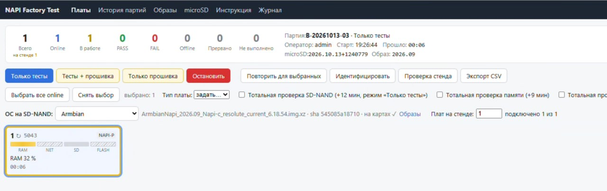

# NAPI Factory Test

Клиент-серверная система производственного тестирования и прошивки до 50 плат NAPI-C / NAPI-P (RK3308)
одновременно. Сервер: FastAPI + SQLite, веб: Vue 3, агент: Python на тестовой Armbian с microSD.



## Статус

Стенд работает на реальных платах: с октября 2026 развёрнут у тестировщика (`hardware_validated: true`),
шьёт и проверяет платы. В коде проверенные на плате места помечены `CHECKED`.

**Проверено на железе**

- распознавание SD-NAND (`mmcblk0` на `ff490000.mmc`, type SD), cpuid из OTP (смещение 7), MAC `end0`;
- RAM: kernel memtest при каждой загрузке тестовой microSD + memtester; NET: iperf3 100Full;
  SD-NAND: паттерн-тест;
- прошивка Armbian на SD-NAND со сверкой, BOOTCHECK по сети (плата загрузилась с SD-NAND и найдена по MAC);
- тип платы: NAPI-C по встроенному Ethernet, NAPI-P по USB-Ethernet адаптеру (сеть не проверяется),
  ручная замена типа;
- образ тестовой microSD, собранный сервером (страница «microSD»), и автообновление агента на картах;
- светодиод `rockpis:blue:user`: у бракованной платы часто мигает, «Идентифицировать» — горит 10 с.

**Ещё не проверено на железе**

- BOOTCHECK для NAPI Linux и Zeroimage на реальной SD-NAND;
- партия на десятки плат одновременно (на симуляторе — 50).

## Быстрый старт (разработка, симулятор)

Нужны Python ≥ 3.11 и Node.js 22.

```sh
# веб
cd web && npm ci && npm run build && cd .. && scripts/deploy-web.sh   # сборка в web/dist-next, установка в web/dist

# сервер
cd server && python3 -m venv .venv && .venv/bin/pip install -e '.[dev]'
NAPI_DB_PATH=/tmp/napi/factory.db NAPI_IMAGES_DIR=/tmp/napi/images NAPI_AGENT_TOKEN=dev-token-0123456789abcdef \
NAPI_ADMIN_PASSWORD=admin NAPI_ALLOW_SIMULATED=1 NAPI_IPERF_ENABLE=0 \
.venv/bin/python -m app.main &
cd ..

# 50 симулированных плат (в отдельном venv агента: pip install websockets==13.1 pyyaml)
python3 examples/simulated-agents/run.py --server ws://127.0.0.1:8080/ws/agent \
    --token dev-token-0123456789abcdef -n 50 --speed 10
```

Открыть http://127.0.0.1:8080, войти `admin` / `admin`, «Выбрать все online» → «Тесты + прошивка».

Что шить на SD-NAND, выбирается в меню «ОС для внутреннего накопителя» (по умолчанию первый пункт — Armbian).
Ссылки на образы ведутся на странице «Образы» (изменения — с повторным вводом пароля); сервер
скачивает образ в `NAPI_IMAGES_DIR` (по умолчанию `/var/lib/napi-factory/images`), проверяет и
раздаёт на тестовые microSD между партиями. Подробно: docs/api.md, раздел 5.

Тестовые microSD: страница «microSD» — образ для скачивания и прошивки через balenaEtcher
(сервер собирает его сам из базы `NAPI_SD_BASE`, текущего агента и своего адреса). Агент на картах
обновляется с сервера сам, между партиями. Инструкция оператора — страница «Инструкция»: открывается
без входа, с неё же без пароля скачивается образ microSD; печатается в PDF. Подробно: docs/api.md, раздел 6.

Параметры симулятора: `--fail-rate` (доля заданий с ошибкой), `--drop-rate` (обрывы связи),
`--boot-fail-rate` (платы без отчёта первой загрузки), `--speed`.

## Тесты

```sh
cd server && .venv/bin/python -m pytest -q     # протокол, API, BOOT, реконнект, планировщик iperf3
cd agent  && .venv/bin/python -m pytest -q     # распознавание SD-NAND на поддельных sysfs, очередь, задания, прошивка
cd web    && npx vitest run && npm run build
```

## Развёртывание

Копированием каталога, venv и одним systemd-юнитом: `sudo deploy/linux-systemd/install.sh`,
затем правка `/etc/napi-factory/server.env` (токен агентов, пароль) и
`systemctl enable --now napi-factory-server`. БД — один файл `/var/lib/napi-factory/factory.db`.
Смена пароля: `python -m app.main --set-password admin`. `deploy/compose.yaml` — опционально.

## Структура

| Каталог | Содержимое |
|---|---|
| `server/` | FastAPI: `/api/v1`, `/ws/agent`, `/ws/ui`, SQLite, планировщик, тесты |
| `web/` | Vue 3 + Vite + TypeScript; `BoardTile.vue`, `StageBar.vue` |
| `agent/` | агент платы: этапы, распознавание накопителей, очередь, Real/Mock бэкенды, тесты |
| `firstboot/` | `napi-firstboot-report` для финального образа (этап BOOT) |
| `config/` | профиль `napi-c-rk3308.yaml`, пример окружения сервера |
| `deploy/` | systemd-юнит, установка, avahi-сервис для mDNS, compose |
| `scripts/make-sd-base.py` | база образа тестовой microSD из проверенной карты |
| `scripts/build-test-sd.sh` | манифест образа и сборка дерева файлов тестовой microSD (ручной способ) |
| `examples/simulated-agents/` | симулятор N плат |
| `docs/` | [архитектура](docs/architecture.md), [API и протокол](docs/api.md), [microSD](docs/provisioning-sd.md), [порядок загрузки](docs/boot-order.md), [предохранители](docs/safety.md), [оператору](docs/operator-guide.md) |

## Не сделано

- HTTP-fallback образа с сервера, привязка к портам коммутатора по SNMP.
- Отдельные учётные записи операторов (сейчас все работают под одним логином).
- Профили плат: сейчас NAPI-C и NAPI-P шьются одним образом и отличаются только проверкой сети.
